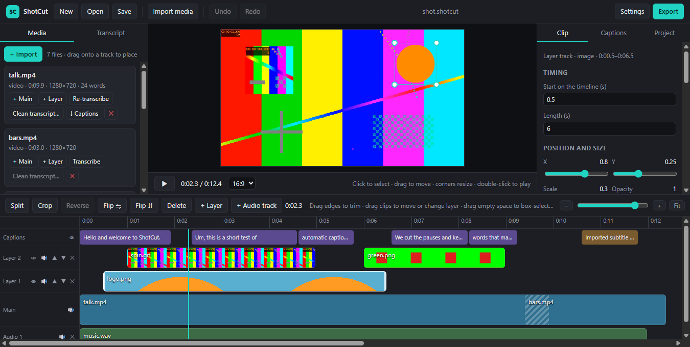

# ShotCut

A local, CapCut-style video editor for Windows with layers, keyframes, accurate auto captions and text-based editing.
It runs offline: Electron for the window, FFmpeg for effects and export, and faster-whisper for speech to text.
The caption pipeline is reused from Transcript QC (`05_Review_QC/Transcript QC`).

Status: **0.3.0** (layers, keyframes, effects, background removal; see [docs/plan.md](docs/plan.md)). It runs from source; there is no installer yet.



## What It Does

| Feature | How |
|:--------|:----|
| Import | Video (MP4, MOV, MKV, WebM, AVI…), audio (MP3, WAV, M4A…), images (PNG, JPG, WebP, BMP), GIF and APNG, subtitles (SRT, VTT); files the preview can't play (HEVC, MKV, ProRes) get a 720p preview copy automatically |
| Where imports go | **+ Import** in the Media panel (always there), Import media in the top bar, or drop files from Explorer on the window. Into an empty timeline, files are placed: videos on the main track, images and GIFs on a layer (or the main track while it is empty), audio on an audio track. Later imports wait in Media: add them with **+ Main** / **+ Layer** / **+ Audio**, or drag them onto a track (main, a layer, an audio track, or the caption row for a new layer). Subtitles go to the caption track |
| Layers | Any number of layer tracks over the main track and audio tracks under it; the top layer is in front; reorder layers (▲▼), hide, mute, delete; drag an item to another layer, or above the top layer for a new one; Bring forward / Send backward; lift a main clip to a layer (picture-in-picture) or put a layer item on the main track |
| Timeline | Ctrl/Shift+click clips (on the timeline or in the preview), or drag a box from empty timeline space across one or more tracks (clips, layer items and captions), to select several for Crop and Delete (Ctrl/Shift+drag adds); split (S) the selected clip, image, GIF or audio at the playhead; drag an edge to trim or lengthen (images and GIFs have no fixed length); drag main clips to reorder; snapping to the playhead and clip edges; every drag is one undo step; zoom with Ctrl + mouse wheel or touchpad pinch (at the pointer), − / + buttons or keys, the slider, or **Fit** (0) to see the whole timeline; importing media or opening a project fits the timeline to the window automatically, and long recordings (hours) zoom out to fit |
| Position, size, crop | Click a picture in the preview to select it, drag to move (snaps to the centre), drag a corner to resize. **Crop** (timeline toolbar, next to Split) opens a crop window for the selected layers: crop box with eight handles, ratios (Free, Original, 16:9, 9:16, 1:1, 4:3, 3:4, which keep their shape while you drag), or typed left/top/right/bottom; Apply gives the same crop to every selected layer and leaves the others alone. The canvas ratio (16:9, 9:16, 1:1, 4:5, 4:3) is next to the play button |
| Keyframes | Add keyframes for position, size and opacity; with keyframes, moving or resizing at the playhead sets a keyframe there; pick the curve to the next keyframe (linear, ease in, ease out, ease in-out, hold) |
| In and out effects | Fade, slide from or to any side, zoom in, zoom out, pop/shrink, with a length; on any picture |
| Transitions | 14 FFmpeg `xfade` transitions between main clips (fade, dip to black/white, wipes, slides, circle, zoom…), now also shown in the preview (CSS look-alikes) |
| Audio | Volume per clip from mute to +20 dB (Web Audio in the preview above 0 dB), fade in and out, mute per track, music and voice-over on audio tracks mixed into the export |
| Background removal | **AI** (U²-Net family models from rembg, run offline with onnxruntime; any subject) or **colour key** (green/blue screen or any plain colour); makes a transparent copy (PNG, APNG or VP9 WebM with alpha) used by preview and export; Restore original |
| Auto captions | Transcribe with faster-whisper (word timings); captions are built from the words that survive your cuts, including voice-overs on audio tracks |
| Caption box | Drag a caption in the preview to move it, drag a side to change the box width, a corner to resize the text; same sliders in the Captions tab |
| All or selected captions | **All captions** (on by default) changes every caption; untick it, pick captions on the caption track or in the preview (Ctrl+click for several), and changes (place, size, font, colours, box, animation) apply only to those; Reset to default style |
| Caption timing | Drag a caption's edges on the caption track; imported subtitle lines can also be dragged whole and their text edited |
| Spoken-word highlight | The current word changes colour, or every word spoken so far (karaoke fill); optional pop; caption fade in, fade out and pop in |
| Caption presets | Classic, Bold pop, Karaoke, Boxed, Subtitle, Neon; one click, then fine-tune (the box place and width you set are kept) |
| Download captions | SRT, WebVTT, styled ASS or plain text of the timeline captions (Captions tab); each transcribed file also has **⤓ Captions** (its own timing), and the transcription card offers the .srt when it finishes |
| Glossary | `wrong => right` fixes for names and terms (e.g. `flora 2 => FLAURA2`), applied to every caption and imported subtitle |
| Clean transcript import | Time a QC-cleaned transcript (one caption per line) against the audio with the Transcript QC aligner |
| Text-based editing | Click a word to jump there; Shift+click to select; **Cut** removes those words from every clip of that file (main track and layers); **Remove fillers**; **Remove pauses** over N seconds |
| Colour | Brightness, contrast, saturation per clip |
| Export | Presets (YouTube 1080p/4K, Shorts · Reels · TikTok, Instagram square, Small file) or custom frame, 720p–4K, 24–60 fps, quality; MP4 (H.264/AAC) with captions burned in; hardware encoder auto-pick (NVENC, Quick Sync, AMF; else x264) |

Not yet: thumbnails on video clips, rotation, text titles as their own layer, LUTs, audio ducking.
See the milestones in [docs/plan.md](docs/plan.md).

## Requirements

- Windows 10/11, Node.js 20+ (tested on 24).
- FFmpeg 7.1 or newer on PATH (tested on 8.1, the "full" build with libvpx), or set its path in Settings.
- Python 3.10+ with faster-whisper: `pip install -r asr/requirements.txt`; for AI background removal also `pip install -r vision/requirements.txt` (onnxruntime, NumPy, Pillow; faster-whisper already brings onnxruntime).
- A Whisper model. The app finds the workspace's offline copy (`hf_cache/faster-whisper-small`) automatically; otherwise set a model folder in Settings, or leave `small` to download it once.
- AI background removal downloads its model once (Silueta 43 MB by default; U²-Net human or IS-Net in Settings) into the app's `models` folder. Colour key needs nothing extra.

## Run

Double-click **`ShotCut.bat`** in the app folder.
To open a project directly, drop a `.shotcut` file onto it.

- The first run installs the app's components (`npm install` and the Electron runtime, about 100 MB), so it needs internet once.
- Each launch rebuilds the interface (about a second), then the console window closes and ShotCut opens.
- It warns if Node.js is missing, or if FFmpeg is not on PATH.
- For a desktop icon: right-click `ShotCut.bat` > **Send to** > **Desktop (create shortcut)**.

From a terminal, the same thing is:

```bash
npm start
```

For development with hot reload, use `npm run dev`.

## Use

1. **Import media** (top bar, or **+ Import** in Media, or drop files on the window): video, audio, images, GIFs, or an `.srt` / `.vtt` file. Add more files at any time; drag them onto a track.
2. In **Media**, press **Transcribe** on a video or audio file. Captions appear when it finishes; **Download captions** is on the card.
3. Arrange: drag clips on the timeline, drag pictures in the preview, select layers (Ctrl+click for several) and press **Crop**, add **keyframes**, pick **in/out effects** and **transitions** in the **Clip** tab.
4. Style captions in the **Captions** tab or by dragging them in the preview; untick **All captions** to change only the captions you pick.
5. Remove a background in the **Clip** tab (**AI** or **Colour key**).
6. **Export** an MP4, or **Download…** the captions. Projects save as `.shotcut` (JSON; media is referenced, not copied). Projects from 0.2 open as they were.

Keys: Space play/pause · S split · Del delete (all selected) · Esc deselect · Ctrl/Shift+click select more · drag on empty timeline space to box-select · ←/→ one frame · Shift+←/→ one second · Ctrl+Z / Ctrl+Y · Ctrl+S · + / − zoom the timeline · 0 fit · Ctrl+wheel zoom at the pointer.
Double-click the preview background to play or pause.

## Files

| Path | What |
|:-----|:-----|
| `electron/main.js` | Window, dialogs, background jobs (preview copy, transcribe, align, background removal, export) |
| `electron/preload.cjs` | The `window.api` bridge (sandboxed, CommonJS) |
| `electron/mediaProtocol.js` | `media://` protocol: serves only allowed local files, with range requests for seeking and CORS for Web Audio |
| `electron/cutout.js` | Background removal: colour key with FFmpeg, AI with `vision/remove_bg.py`, model download |
| `electron/export.js`, `media.js`, `asr.js`, `tools.js`, `proc.js` | FFmpeg export, probe and proxies, the Python sidecar, settings and tool lookup, process runner and file moves (no Electron imports, so tests use them) |
| `core/` | Pure logic shared by preview, export and tests: project and track ops, layout (`project.js`), transforms, keyframes, effects and placement (`anim.js`), transcript ops, caption cues, overrides and SRT/VTT/ASS (`captions.js`), FFmpeg graph (`exportPlan.js`), probe parsing (`media.js`) |
| `src/` | React interface (Vite); `src/playback.js` is the two-video main-track engine, `src/stage.js` maps placement and transitions to CSS, `src/audio.js` the preview gain |
| `asr/transcribe.py` | faster-whisper word timings (from Transcript QC `run_asr.py`) |
| `asr/make_exact_srt.py` | Transcript QC aligner, copied unchanged |
| `asr/align.py` | Wraps the aligner to return timed words with caption breaks |
| `vision/remove_bg.py` | AI background removal: FFmpeg decodes frames, an ONNX U²-Net model makes the matte, FFmpeg encodes PNG/APNG/VP9 alpha (`vision/requirements.txt`) |
| `dev/` | Tests, sample makers, smoke and end-to-end checks, dev server launcher |
| `docs/plan.md` | Architecture, milestones, risks |
| `ShotCut.bat` | Double-click launcher: installs on first run, rebuilds the interface, opens the app (CRLF, see `.gitattributes`) |

## Tests

```bash
npm run samples
```

```bash
npm test
```

- `npm run samples` makes `dev/samples/` (a Windows-voice speech clip, a talking test-pattern video, colour bars); the layer samples (logo, GIF, green screen, music, SRT) are made on first use.
- `npm test` runs the `core/` unit tests, the playback engine with fake videos, real FFmpeg exports (duration, frame size, caption pixels; layers with keyframes, crop, fade, GIF, alpha WebM, per-caption placement, audio mix), background removal (colour key, and the AI path with a stand-in ONNX model made by `dev/tools/fake_matte_model.py`, so no download), and a real transcription + alignment (skipped when Python, the model or the samples are missing).
- `npm run smoke` opens the real window on a sample project and saves `dev/out/smoke.png`.
- `npm run e2e` drives the real window over the DevTools protocol with real mouse input, in two runs:
  - `dev/tools/e2e.mjs` (18 checks): drag-trim, drag-reorder, undo, text cut, gap-free playback, caption and export presets, Settings.
  - `dev/tools/e2e-layers.mjs` (49 checks): layer placement and stacking, click-select, Ctrl+click multi-select, box select across layers, the main track and captions, move with snap, corner resize, the Crop window on two layers (others untouched), keyframes and curves, fade-in, moving items between layers, +6 dB through Web Audio, the transition preview, moving the caption box for all and for selected captions, caption trim, subtitle move, colour-key background removal, timeline zoom (Ctrl+wheel anchor, buttons, keys, Fit), later imports landing in Media, a file dropped on the window, dragging media onto a track, and a 70-minute file fitting the window.
  - Screenshots go to `dev/out/e2e-*.png`.

## How Export Works

One FFmpeg run, with the graph written to `graph.txt` (`-/filter_complex`) and FFmpeg running inside the job folder, so long timelines never hit the Windows command-line limit and file paths never need escaping inside the graph.

- **Main track:** each clip is read with `-ss/-t`, scaled to the frame (or, when it is cropped, moved, animated, transparent or a still, drawn on a black canvas), colour-adjusted (`eq`), trimmed to whole frames, and joined with `xfade` + `acrossfade` or `concat`.
- **Layers:** each item is cropped, faded and scaled, then `overlay`ed at its time, bottom layer first. Images loop (`-loop 1`), GIFs loop (`-ignore_loop 0`), transparent WebM is decoded with libvpx to keep the alpha.
- **Animation:** keyframes and in/out effects become expressions in `t` (`overlay x/y`, `scale` with `eval=frame`, `geq` for changing opacity), piecewise linear through the same per-frame values the preview uses, so every frame matches and runs are deterministic.
- **Audio:** volume (`volume=…dB`) and fades (`afade`) per clip, items delayed to their time (`adelay`) and mixed (`amix`, no normalisation).
- **Captions:** burned in with libass (`ass=captions.ass`); each distinct caption look is its own ASS style, with the box place and width as margins.

## Limits

- `electron . project.shotcut` opens a project from the command line.
- Preview colour uses CSS filters, an approximation of FFmpeg's `eq`; transitions in the preview are CSS look-alikes of `xfade`; the export is the reference.
- GIFs animate on their own in the preview (not frame-locked to the playhead); the export is frame-exact.
- AI background removal processes every frame on the CPU, so long videos take a while (IS-Net is the slowest); colour key is much faster. The pipeline is tested with a stand-in model; the real models download on first use. A transparent video copy is VP9 WebM, so it is larger than the original.
- Burned-in fonts must be installed on the PC (the list uses Windows fonts).
- For distribution, bundle an LGPL FFmpeg build (with libvpx); the "full" builds are GPL.

## Licence

MIT, see [LICENSE](LICENSE). FFmpeg, Electron, React, faster-whisper, onnxruntime and the rembg models (Apache-2.0) keep their own licences.
